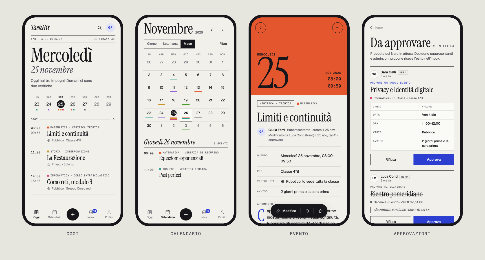
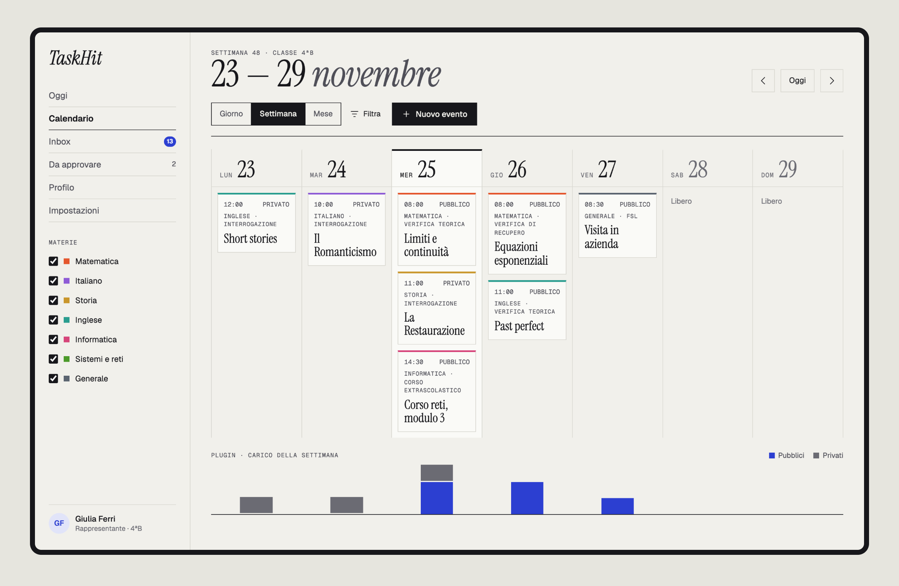
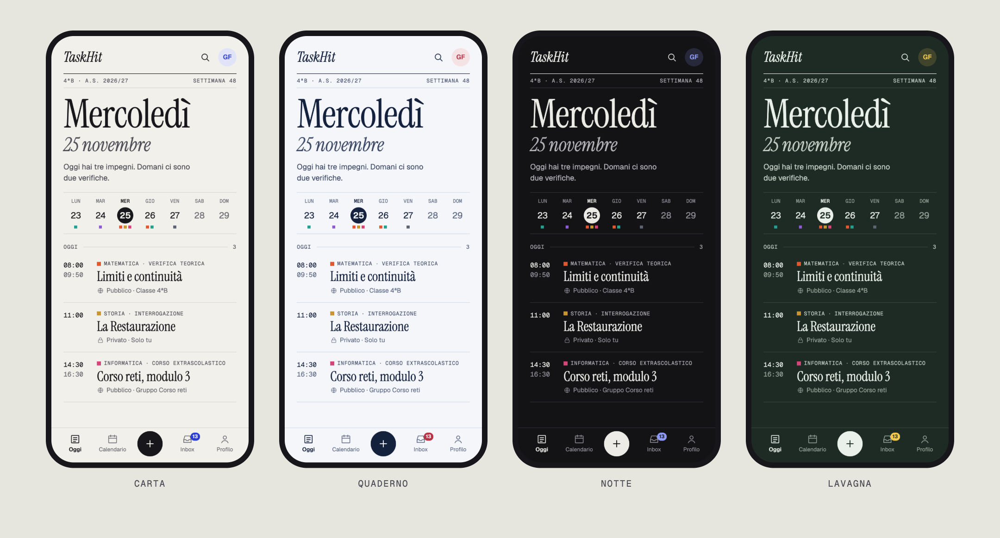

<p align="center">
  <picture>
    <source media="(prefers-color-scheme: dark)" srcset="docs/brand/logo-scuro.svg">
    
  </picture>
</p>

<p align="center">
  <strong>Il calendario condiviso della classe, da ospitare a casa.</strong><br>
  Verifiche e interrogazioni per tutti, impegni privati cifrati sul dispositivo.
</p>

<p align="center">
  <a href="https://github.com/tombino104/TaskHit/actions/workflows/docker.yml"></a>
  <a href="LICENSE"></a>
</p>



*Le schermate usano dati di prova con nomi inventati.*

## Cosa fa

- **Calendario** per giorno, settimana e mese, con materie colorate, tipi di evento, filtri e ricerca.
- **Eventi privati** cifrati sul dispositivo: nemmeno l'amministratore del server li riceve in chiaro.
- **Ruoli**: l'admin gestisce solo il server (persone, ruoli, classi, backup) e non fa parte della classe; i rappresentanti gestiscono eventi, inviti, gruppi interni alla classe e plugin; le modifiche dei nerd aspettano la loro approvazione; gli alunni hanno eventi privati.
- **Inbox** con aggiunte, modifiche ed eliminazioni degli eventi pubblici.
- **Classi, gruppi e inviti** con conferma dell'amministratore.
- **Temi** in un singolo file JSON, chiari e scuri.
- **Consultazione offline** e installazione come app (PWA) su telefono e computer.
- **Grafico del carico** della settimana.

**In arrivo:** notifiche push, plugin installabili, caricamento dei temi dall'app, cambio e recupero della password.

I limiti di sicurezza e ciò che non è stato verificato sono in [`ARCHITETTURA.md`](ARCHITETTURA.md): leggilo prima di affidare all'app dati veri.

## Sul computer



## Temi



## Com'è fatta

Server in **Rust** (Axum, SQLite con SQLCipher) e interfaccia in **Svelte 5** + TypeScript, distribuiti in un'unica immagine Docker.

## Provarlo in locale

```bash
# 1. interfaccia
cd web && npm ci && npm run build && cd ..

# 2. server (senza cifratura del database, solo per prove; cookie non Secure perché http)
cd server
TASKHIT_DATA_DIR=./data TASKHIT_WEB_DIR=../web/dist TASKHIT_BIND=127.0.0.1:8080 TASKHIT_COOKIE_SECURE=false \
  cargo run --release
# apri http://127.0.0.1:8080 e segui la configurazione guidata
```

Sviluppo dell'interfaccia con ricarica a caldo: `cd web && npm run dev` (inoltra `/api` a `127.0.0.1:8080`).

## Test

```bash
cd server && cargo test                 # 20 test di integrazione e 1 unitario
cd web && npm test                      # crittografia, date, eventi, temi
cd web && npx svelte-check --tsgo       # tipi

# end-to-end del client contro un server vuoto in esecuzione
cd web && TASKHIT_E2E_URL=http://127.0.0.1:8080 npx vitest run src/lib/e2e.test.ts
```

## Produzione

- **Immagine**: ogni tag `v*` la costruisce con GitHub Actions per `amd64` e `arm64` (SQLCipher incluso) e la pubblica come `ghcr.io/tombino104/taskhit:<versione>`.
- **Configurazione**: `config.example.toml` o variabili `TASKHIT_*`.
- **HTTPS obbligatorio**: fuori da `localhost`, in HTTP il browser disattiva la crittografia e l'app mostra «Serve HTTPS».
- **Primo avvio**: crea subito l'amministratore. Il setup è bloccato per chi arriva dal tunnel Cloudflare, salvo `TASKHIT_ALLOW_REMOTE_SETUP=true`.

## Installazione su UmbrelOS

> Non ancora provata su un Umbrel vero: vedi [`ARCHITETTURA.md`](ARCHITETTURA.md).

1. Serve un [community app store](https://github.com/getumbrel/umbrel-community-app-store): un repository con `umbrel-app-store.yml` nella radice. Se non ne hai uno, parti dal contenuto di `umbrel-store/`.
2. Copia nello store la cartella `umbrel-store/tombino104-taskhit/`. Il nome della cartella e l'`id` dell'app devono iniziare con l'`id` dello store.
3. In UmbrelOS aggiungi lo store e installa TaskHit.
4. Dai all'app un indirizzo HTTPS (per esempio con un tunnel Cloudflare) e imposta `TASKHIT_PUBLIC_URL`.
5. Apri quell'indirizzo e completa la configurazione guidata. Se passi dal tunnel, imposta `TASKHIT_ALLOW_REMOTE_SETUP: "true"` solo il tempo di creare l'amministratore, poi toglilo.

## Backup

Da *Profilo → Backup* l'amministratore sceglie quando farli (di partenza: ogni notte alle 03:00, conservando gli ultimi 14), li scarica e li ripristina.

- **Cosa contengono**: database, la chiave che lo apre e i temi. Chi ha il file ha i dati pubblici e gli account: conservalo al sicuro. Gli eventi privati restano cifrati.
- **Dove stanno**: in `backups/` dentro la cartella dei dati. Se disinstalli l'app o si guasta il disco spariscono con lei: scaricali ogni tanto, oppure scegli una cartella per la seconda copia (su Umbrel nelle impostazioni dell'app; altrove con `TASKHIT_BACKUP_COPY_DIR`). La seconda copia non viene mai sfoltita.
- **Ripristino**: dall'archivio, con la password; prima viene salvata una copia dello stato attuale e poi tutti accedono di nuovo. Su un'installazione nuova: *Hai un backup? Ripristinalo*, nella prima schermata (dall'indirizzo di casa).

## Licenza

[PolyForm Noncommercial 1.0.0](LICENSE): il codice è visibile (*source-available*), l'uso non commerciale è libero, l'uso commerciale e la rivendita sono vietati. Non è una licenza open source.
